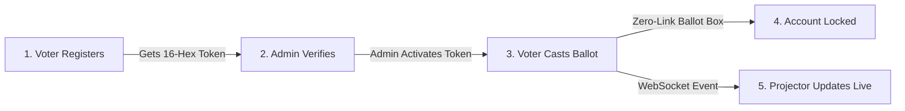

# 🗳️ Votin-pool

> **A high-integrity, local-network (air-gapped / Wi-Fi) voting portal built for zero-cheat elections, physical voter verification, and live projector telemetry.**

Built with **Node.js (Express & Socket.io)** and **SQLite**. Zero cloud dependency. Engineered for college elections, student clubs, hackathons, and local governance events.

---

## ⚡ Key Highlights & Architecture

- **Strict One-Person, One-Vote Integrity:** Microsecond atomic Compare-And-Swap (CAS) locking in SQLite prevents race condition attacks and double-voting.
- **Physical Verification Barrier (Out-of-Band Activation):** Users register and receive a unique 16-character cryptographic hex token (`crypto.randomBytes(8)`). An election administrator must physically verify identity and activate the token in the Admin Console before voting booths open.
- **Secret Ballot Decoupling:** Complete separation of identity (`users`) and ballot submissions (`votes`). Ballots are recorded anonymously with zero relational linkage to user records.
- **Real-Time Projector Telemetry (`/projector`):** Dedicated full-screen responsive dashboard broadcasting live bar charts and percentages via Socket.io with zero page reloads.
- **Candidate Roster Management:** Admins can add, edit, or delete candidates. Deleting candidates with cast votes is automatically blocked to prevent tally corruption.
- **One-Click Safe Reset:** Clear all test ballots and registered users with a double-confirmation prompt without modifying candidate rosters.
- **Anti-Cache & Anti-Replay Session Guards:** HTTP `Cache-Control: no-store` and `pageshow` guards ensure hitting browser "Back", refreshing, or re-logging instantly directs voted users to a sealed lock screen.

---

## 🏁 Quickstart & Installation

### 1. Prerequisites
- **Node.js** v20+ (Node v22+ or v24+ recommended with native `node:sqlite` support).
- **Git**

### 2. Clone Repository & Install
```bash
git clone https://github.com/N0tHin8/Votin-pool.git
cd Votin-pool

# Install dependencies (Express, Socket.io, Express-Session)
npm install
```

### 3. Launch the Server
```bash
npm start
```
The console will display your local IP addresses:
```text
========================================================
🛡️  LAN TOKEN-VOTING SYSTEM RUNNING
========================================================
Local Access:        http://localhost:3000
LAN Voter Access:    http://192.168.1.105:3000
LAN Projector View:  http://192.168.1.105:3000/projector
LAN Admin Dashboard: http://192.168.1.105:3000/admin
Default Admin:       admin / admin123
========================================================
```

---

## 🧭 How to Run an Election (Step-by-Step)



1. **Setup Display:** Connect a second monitor or projector and navigate to `http://<your-lan-ip>:3000/projector`. Click **Fullscreen**.
2. **Admin Station:** Open `http://localhost:3000/admin`. Log in with `admin` / `admin123`.
3. **Voter Registration:** Voters connect to the local Wi-Fi and open `http://<your-lan-ip>:3000` on their phone/browser:
   - Click **Register New Voter**.
   - Input username and password.
   - The screen presents their unique **16-Hex Token** (e.g., `4F9B2A10C83E551D`).
4. **Physical Verification:** The voter shows their token to the admin in person. The admin enters or clicks **Activate** in the Admin Console.
5. **Casting Ballot:** The voter signs in, picks a candidate, and submits.
6. **Strict Lockdown:** The voter's account is stamped as `VOTED`. If they refresh, press Back, or sign in again, they are locked out on the **Vote Already Cast** screen.

---

## 🎛️ Admin Controls & Resetting Data

Log into `/admin` to access:
- **Token Activation Input:** Input 16-hex token to unlock booths for verified attendees.
- **Candidate Management:** Add new candidates, update platform descriptions, or customize bar chart colors.
- **Clear All Votes & Users:** Click **Clear All Votes & Users** in the top navbar. You will be prompted to type `RESET` to wipe all test ballots and reset the tally back to 0 without deleting candidate profiles.

---

## 🚩 Hack Aalu CTF Challenge Reference

> *Dedicated with pride for the **Hack Aalu CTF** community.* 🥔
> 
> Can you bypass the token activation boundary, execute a race condition against SQLite WAL locks, or extract ballot choices without touching the decoupled ledger?
>
> ```text
>        [ Hack Aalu CTF Flag Inspection Matrix ]
> 
>   [Voter Session] ---> (POST /api/vote) ---> [SQLite IMMEDIATE CAS]
>          |                                         |
>          v                                         v
>  [Token: PENDING]                           [Status: VOTED]
>  [HTTP 403 BLOCKED]                         [FLAG_VOTER_INTEGRITY]
> 
>   Challenge Vectors:
>   - TOCTOU Concurrency Fuzzing
>   - Timing Safe Hex Token Equality Checks
>   - Secret Ballot Decoupling Audits
> ```

---

## 🛡️ Security Implementations

| Security Defense | Implementation Detail |
| :--- | :--- |
| **Race Condition Guard** | SQLite `BEGIN IMMEDIATE` + Atomic CAS (`UPDATE users SET status = 'VOTED' WHERE id = ? AND status = 'ACTIVATED'`). Returns `409 Conflict` on collisions. |
| **Ballot Privacy** | Anonymous ballot box: `votes` table contains zero `user_id` or `token` foreign keys. |
| **Entropy** | Cryptographic 64-bit random tokens via `crypto.randomBytes(8).toString('hex')`. |
| **Cache Bypassing** | `Cache-Control: no-store, no-cache, must-revalidate` + DOM `pageshow` history traversal invalidation. |
| **Password Storage** | Salted `scrypt` key derivation with constant-time buffer comparison (`crypto.timingSafeEqual`). |

---

## 📄 License
MIT License. Open-source for colleges, clubs, and transparent local governance.
